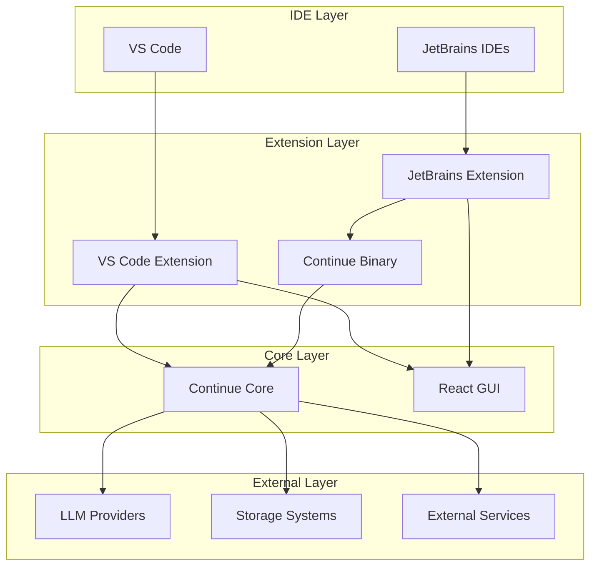
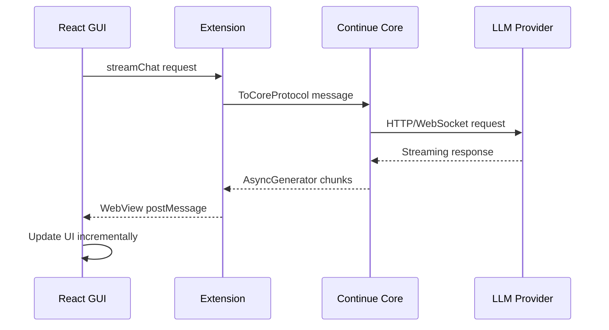

# Continue Architecture Documentation

## Table of Contents

1. [Overview](#overview)
2. [High-Level Architecture](#high-level-architecture)
3. [Core Components](#core-components)
4. [Extension Architecture](#extension-architecture)
5. [GUI Architecture](#gui-architecture)
6. [Communication Protocols](#communication-protocols)
7. [Data Flow](#data-flow)
8. [Configuration System](#configuration-system)
9. [Indexing & Context](#indexing--context)
10. [LLM Integration](#llm-integration)
11. [Plugin System](#plugin-system)
12. [Security Model](#security-model)
13. [Build & Distribution](#build--distribution)
14. [Development Patterns](#development-patterns)

## Overview

Continue is an open-source AI code assistant that provides chat, autocomplete, edit, and agent functionality across VS Code and JetBrains IDEs. The architecture is designed around a shared TypeScript core with platform-specific extensions.

### Key Design Principles

- **Cross-platform consistency**: Same functionality across different IDEs
- **Type safety**: Comprehensive TypeScript interfaces and protocol definitions
- **Extensibility**: Plugin architecture for context providers, commands, and LLM providers
- **Performance**: Streaming responses, incremental indexing, and efficient caching
- **Security**: Sandboxed execution and configurable permissions

## High-Level Architecture



## Core Components

### 1. Continue Core (`/core`)

The heart of Continue, implemented as a TypeScript library that provides:

#### Core Class (`core/core.ts`)
```typescript
export class Core {
  configHandler: ConfigHandler;
  codebaseIndexer: CodebaseIndexer;
  completionProvider: CompletionProvider;
  ide: IDE;
  
  // 280+ protocol methods
  async streamChat(request: ChatRequest): AsyncGenerator<ChatResponse>;
  async getCodebaseIndexStatus(): Promise<IndexStatus>;
  async autocomplete(request: AutocompleteRequest): Promise<AutocompleteResponse>;
}
```

**Responsibilities:**
- Central orchestration of all functionality
- Message routing and protocol handling
- Configuration management
- LLM interaction coordination
- Context retrieval and management

#### Key Modules

**Configuration Handler (`core/config/ConfigHandler.ts`)**
- Multi-source configuration loading (local, workspace, remote)
- Real-time configuration updates
- Profile and organization management
- YAML and JSON format support

**Codebase Indexer (`core/indexing/CodebaseIndexer.ts`)**
- File system monitoring and indexing
- AST parsing with Tree-sitter
- Vector embeddings generation
- Multiple storage backends (LanceDB, SQLite)

**Completion Provider (`core/autocomplete/CompletionProvider.ts`)**
- Inline code completion
- Context-aware suggestions
- Multi-line completion support
- Language-specific processing

**Context Providers (`core/context/providers/`)**
- 25+ built-in providers
- Dynamic context retrieval
- MCP (Model Context Protocol) integration
- Custom provider plugin system

### 2. Protocol System (`core/protocol/`)

Type-safe communication layer with comprehensive message definitions:

#### Protocol Interfaces
```typescript
// Core ↔ IDE communication (280+ methods)
interface ToCoreProtocol {
  "config/reload": [void, void];
  "llm/streamChat": [ChatRequest, AsyncGenerator<ChatResponse>];
  "autocomplete/complete": [AutocompleteRequest, AutocompleteResponse];
  "index/forceReIndex": [void, void];
  // ... 276 more methods
}

// GUI ↔ Extension communication (50+ methods)
interface ToWebviewProtocol {
  "setInactive": [void, void];
  "addContextItem": [ContextItem, void];
  "updateSubmenuItems": [SubmenuItem[], void];
  // ... 47 more methods
}
```

#### Message Routing
- **VS Code**: `InProcessMessenger` (same Node.js process)
- **JetBrains**: `IpcMessenger` (cross-process via stdin/stdout)
- **Development**: `TcpMessenger` (TCP socket for debugging)

## Extension Architecture

### VS Code Extension (`/extensions/vscode`)

#### Extension Lifecycle
```typescript
// extensions/vscode/src/extension.ts
export async function activate(context: vscode.ExtensionContext) {
  const ide = new VsCodeIde();
  const messenger = new InProcessMessenger();
  const core = new Core(messenger, ide);
  
  // Register webview provider
  const provider = new ContinueGUIWebviewViewProvider(context, ide, core);
  context.subscriptions.push(
    vscode.window.registerWebviewViewProvider("continue.continueGUIView", provider)
  );
}
```

#### Key Components

**VsCodeIde Implementation**
- Implements 160+ IDE interface methods
- File system operations via VS Code API
- Git integration using VS Code's Git API
- Terminal access and command execution
- Workspace management and settings

**Webview Integration**
- React GUI hosted in VS Code webview
- Bidirectional message passing via `window.postMessage`
- CSP-compliant resource loading
- Theme synchronization

### JetBrains Extension (`/extensions/intellij`)

#### Architecture Overview
```kotlin
// Kotlin-based extension with Node.js binary integration
class ContinuePluginStartupActivity : StartupActivity {
    override fun runActivity(project: Project) {
        val messenger = CoreMessengerManager.getInstance(project)
        messenger.startCoreMessenger()
    }
}
```

#### Binary Integration
- Spawns separate Node.js process running Continue Core
- IPC communication via stdin/stdout JSON-RPC
- Process lifecycle management
- Error handling and recovery

**CoreMessengerManager**
- Process spawning and monitoring
- Message queue management
- Binary path resolution
- Development vs production mode handling

## GUI Architecture

### React Application (`/gui`)

#### Technology Stack
- **React 18** with hooks and functional components
- **Redux Toolkit** for state management
- **Vite** for build tooling and development
- **Tailwind CSS** for styling
- **TypeScript** for type safety

#### Key Components

**Message Communication**
```typescript
// gui/src/context/IdeMessenger.tsx
class IdeMessenger {
  postToIde(messageType: string, data: any): void {
    if (window.vscode) {
      // VS Code webview API
      window.vscode.postMessage({ messageType, data });
    } else {
      // JetBrains custom messaging
      window.postIntellijMessage?.(messageType, data);
    }
  }
}
```

**Protocol Integration**
```typescript
// Type-safe message handling
const useWebviewListener = <T extends keyof FromWebviewProtocol>(
  messageType: T,
  handler: (data: FromWebviewProtocol[T][0]) => void
) => {
  // WebSocket-like listener with full type safety
};
```

#### State Management
- **Redux Store**: Global application state
- **Local State**: Component-specific state with hooks
- **Context Providers**: Theme, authentication, IDE integration
- **Persistent Storage**: LocalStorage for user preferences

#### UI Components
- **Chat Interface**: Markdown rendering, code highlighting, streaming
- **File Explorer**: Tree view with search and filtering
- **Settings Panel**: Configuration management UI
- **Context Menu**: Right-click actions and quick commands

## Communication Protocols

### Message Flow Architecture



### Protocol Definitions

#### Core Protocol (`ToCoreProtocol`)
- **Configuration**: `config/*` (reload, getBranch, etc.)
- **LLM Operations**: `llm/*` (streamChat, streamComplete, etc.)
- **File Operations**: `readFile`, `writeFile`, `saveFile`
- **Indexing**: `index/*` (forceReIndex, pauseCodebaseIndexer, etc.)
- **Context**: `context/*` (getContextItems, loadSubmenuItems, etc.)
- **Autocomplete**: `autocomplete/*` (complete, cancel, accept, etc.)

#### Webview Protocol (`ToWebviewProtocol`)
- **State Management**: `setInactive`, `addContextItem`
- **Configuration Updates**: `configUpdate`, `workspaceDirectoryUpdate`
- **UI Updates**: `updateSubmenuItems`, `refreshCodebaseIndexer`
- **Error Handling**: `errorPopup`, `showToast`

### Type Safety
- Full TypeScript coverage across all protocols
- Compile-time validation of message types
- Runtime validation with Zod schemas
- IDE autocomplete for all protocol methods

## Data Flow

### Chat Flow
1. **User Input**: User types message in GUI
2. **Context Gathering**: Core retrieves relevant context (files, docs, etc.)
3. **LLM Request**: Core formats prompt and sends to LLM provider
4. **Streaming Response**: LLM streams tokens back through Core to GUI
5. **UI Update**: GUI renders response incrementally with syntax highlighting

### Autocomplete Flow
1. **Trigger**: User types, triggering autocomplete request
2. **Context Analysis**: Core analyzes current file and surrounding context
3. **Model Inference**: Specialized autocomplete model generates suggestions
4. **Filtering**: Post-processing filters and ranks suggestions
5. **Display**: Extension shows inline suggestions to user

### Indexing Flow
1. **File Watching**: Core monitors workspace files for changes (respects .continueignore)
2. **AST Parsing**: Tree-sitter parses code into structured format
3. **Chunking**: Code split into semantic chunks
4. **Embedding**: Chunks converted to vector embeddings
5. **Storage**: Embeddings stored in vector database (LanceDB)
6. **Retrieval**: Context queries use vector similarity search

## Configuration System

### Configuration Sources
1. **Local Config**: `~/.continue/config.yaml`
2. **Workspace Config**: `.continuerc.json` in project root  
3. **Remote Config**: Fetched from Continue Hub
4. **Environment Variables**: Override specific settings
5. **Ignore Files**: `.continueignore` for autocomplete indexing exclusions

### Configuration Schema
```yaml
# config.yaml structure
models:
  - title: "GPT-4"
    provider: "openai"
    model: "gpt-4"
    apiKey: "${OPENAI_API_KEY}"
    # Per-model autocomplete options (new in recent commits)
    autocompleteOptions:
      debounceDelay: 300
      maxPromptTokens: 1000
      multilineCompletions: enabled
      useCache: true

customCommands:
  - name: "test"
    prompt: "Write unit tests for this code"

contextProviders:
  - name: "codebase"
    params:
      nRetrieve: 25

# MCP servers with new streamable-http support
mcpServers:
  my-server:
    command: "my-server"
    type: "streamable-http"  # New option alongside "sse" and "stdio"

rules:
  - "Always write TypeScript instead of JavaScript"
```

### Profile Management
- **Organizations**: Multi-tenant support for teams
- **Profiles**: Different configurations per project
- **Inheritance**: Hierarchical configuration merging
- **Validation**: Schema validation with helpful error messages

## Indexing & Context

### Codebase Indexing

#### Vector Database (LanceDB)
```typescript
interface CodeSnippet {
  filepath: string;
  range: Range;
  content: string;
  embedding: Float32Array;
  metadata: {
    language: string;
    symbols: string[];
    dependencies: string[];
  };
}
```

#### Full-Text Search
- SQLite FTS5 for exact text matching
- Complementary to vector search
- Support for regex and complex queries
- File path and content indexing

#### AST-Based Chunking
- Language-specific parsing with Tree-sitter
- Semantic boundaries (functions, classes, etc.)
- Configurable chunk sizes and overlap
- Preservation of code structure

### Context Providers

#### Built-in Providers
- **Codebase**: Vector similarity search across indexed code
- **Files**: Direct file content inclusion
- **Git**: Commit history and diff analysis
- **Docs**: Documentation site indexing
- **Web**: Real-time web search and scraping
- **Database**: SQL query execution and schema analysis
- **Terminal**: Command output capture
- **Problems**: IDE error and warning integration

#### MCP Integration
```typescript
// Model Context Protocol support with enhanced connectivity
interface MCPProvider {
  name: string;
  command: string;
  args: string[];
  serverUrl?: string;
  type?: "sse" | "stdio" | "streamable-http"; // New streamable-http support
}
```

## LLM Integration

### Provider Architecture

#### Base LLM Class
```typescript
abstract class BaseLLM {
  abstract streamChat(messages: ChatMessage[]): AsyncGenerator<string>;
  abstract streamComplete(prompt: string): AsyncGenerator<string>;
  
  // Optional capabilities
  supportsImages?(): boolean;
  supportsFunctionCalling?(): boolean;
  supportsParallelToolCalls?(): boolean;
}
```

#### Supported Providers
- **OpenAI**: GPT-3.5, GPT-4, GPT-4V
- **Anthropic**: Claude family
- **Open Source**: Ollama, LlamaCpp, vLLM
- **Cloud Providers**: Azure OpenAI, Bedrock, Vertex AI
- **Specialized**: Codestral, DeepSeek Coder, Inception Labs

### Model Roles
- **Chat**: Primary conversation model (GPT-4, Claude)
- **Autocomplete**: Fast completion model (CodeLlama, Codestral)
- **Edit**: Code modification model (GPT-3.5, Claude Haiku)
- **Embeddings**: Context retrieval (text-embedding-ada-002)
- **Reranking**: Context relevance scoring (specialized models)

### Streaming Architecture
```typescript
// Efficient streaming with backpressure handling
async function* streamLLMResponse(
  messages: ChatMessage[]
): AsyncGenerator<ChatResponse> {
  const stream = await llm.streamChat(messages);
  
  for await (const chunk of stream) {
    yield {
      content: chunk,
      done: false,
      tokens: await countTokens(chunk)
    };
  }
  
  yield { content: "", done: true };
}
```

## Plugin System

### Context Provider Plugins
```typescript
interface IContextProvider {
  get description(): ContextProviderDescription;
  getContextItems(
    query: string,
    extras: ContextProviderExtras
  ): Promise<ContextItem[]>;
  loadSubmenuItems?(): Promise<ContextSubmenuItem[]>;
}
```

### Slash Command Plugins
```typescript
interface SlashCommand {
  name: string;
  description: string;
  run(input: SlashCommandInput): AsyncGenerator<string>;
  params?: { [key: string]: any };
}
```

### Custom Tools
```typescript
interface Tool {
  name: string;
  description: string;
  parameters: JSONSchema;
  call(params: any, extras: ToolCallExtras): Promise<string>;
}
```

## Security Model

### Sandboxing
- **Process Isolation**: JetBrains binary runs in separate process
- **API Boundaries**: Well-defined interfaces between components
- **Permission System**: Configurable tool and provider permissions

### Data Protection
- **Local Processing**: Embeddings can be computed locally
- **API Key Management**: Secure storage and environment variable support
- **Telemetry Controls**: Opt-in analytics with privacy controls

### Network Security
- **Certificate Validation**: Proper SSL/TLS verification
- **Proxy Support**: Corporate proxy configuration
- **Rate Limiting**: Built-in request throttling

## Build & Distribution

### VS Code Extension
```bash
# Build pipeline
npm run esbuild        # Bundle with esbuild
npm run package        # Create .vsix file
vsce publish           # Publish to marketplace
```

### JetBrains Extension
```bash
# Gradle build
./gradlew buildPlugin  # Create plugin ZIP
./gradlew publishPlugin # Publish to JetBrains marketplace
```

### Binary Distribution
```bash
# PKG compilation
npm run build:binary   # Compile Node.js to native binary
npm run package:binary # Create platform-specific packages
```

### Multi-Platform Support
- **macOS**: x64 and ARM64 binaries
- **Windows**: x64 and ARM64 binaries  
- **Linux**: x64 and ARM64 binaries
- **Alpine Linux**: musl-based distributions

## Development Patterns

### Testing Strategy
- **Unit Tests**: Jest for core logic
- **Integration Tests**: Cross-component communication
- **E2E Tests**: Full user workflow validation
- **Performance Tests**: Indexing and completion benchmarks

### Code Organization
- **Monorepo Structure**: Shared dependencies and tooling
- **TypeScript First**: Strong typing throughout
- **Protocol-Driven**: Interface definitions drive implementation
- **Modular Design**: Pluggable architecture

### Error Handling
```typescript
// Comprehensive error boundaries
class ContinueError extends Error {
  constructor(
    message: string,
    public code: string,
    public metadata?: any
  ) {
    super(message);
  }
}

// Graceful degradation
async function safelyCallLLM(request: ChatRequest): Promise<ChatResponse> {
  try {
    return await llm.streamChat(request);
  } catch (error) {
    if (error instanceof NetworkError) {
      return fallbackResponse("Network error occurred");
    }
    throw error;
  }
}
```

### Performance Optimizations
- **Lazy Loading**: On-demand module loading
- **Caching**: Multi-level caching (memory, disk, remote)
- **Debouncing**: Request deduplication and batching
- **Worker Threads**: CPU-intensive operations in background

## Recent Enhancements

### Latest Features (June 2025)

#### 1. Enhanced Autocomplete Configuration
- **Per-Model Settings**: Each model can now specify individual `autocompleteOptions` in config.yaml
- **Granular Control**: Configure debounce delay, token limits, caching, and completion behavior per model
- **Backward Compatibility**: Global settings remain as fallbacks when per-model options aren't specified

#### 2. Improved Ignore Handling  
- **.continueignore Support**: Autocomplete indexing now respects `.continueignore` files
- **Workspace-Level Control**: Place `.continueignore` in project root to exclude files/folders from indexing
- **Gitignore-Style Patterns**: Uses same pattern matching as `.gitignore` files
- **Performance Optimization**: Reduces indexing overhead by skipping unwanted files

#### 3. Inception Labs Provider
- **New LLM Provider**: Added support for Inception Labs' OpenAI-compatible API
- **FIM Support**: Fill-in-the-Middle completions for enhanced autocomplete
- **Multiple Endpoints**: Different servers for different model variants (Mercury Editor Mini/Small)
- **Optimized Defaults**: Preconfigured temperature, penalties, and stop tokens

#### 4. Enhanced MCP Connectivity
- **Streamable HTTP**: New connection type for Model Context Protocol servers
- **Real-time Communication**: Improved streaming capabilities for context providers
- **Flexible Architecture**: Choose between SSE, stdio, or streamable-http based on use case
- **Better Integration**: Enhanced support for external context sources

These enhancements maintain Continue's core architecture while significantly improving user control, performance, and integration capabilities.

---

This architecture enables Continue to provide a sophisticated AI coding assistant while maintaining performance, security, and extensibility across multiple IDE platforms.